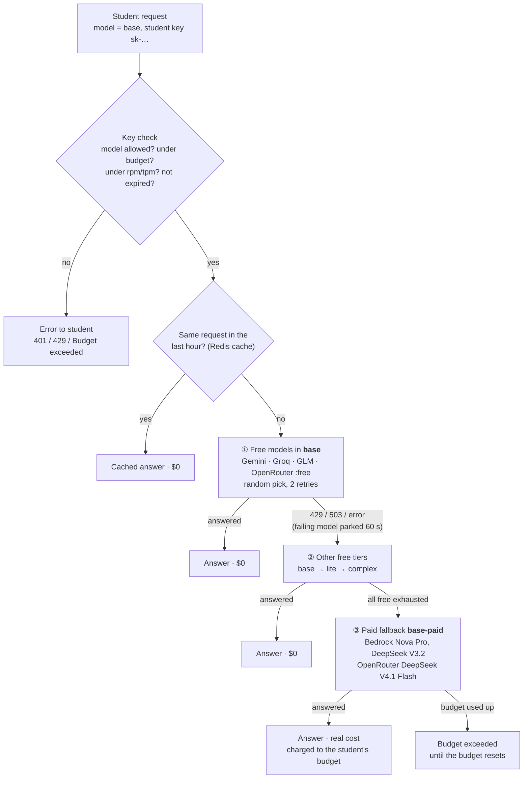

# LiteLLM Gateway on AWS

One OpenAI-compatible HTTPS endpoint for many AI models, running on a small EC2 server in Mumbai.
Each person gets their own key; usage is tracked per person.

| | |
|---|---|
| **URL** | `https://3-111-59-142.sslip.io` (admin UI: `/ui`) |
| **Models** | Free (Gemini, Groq, OpenRouter, GLM): `lite`, `base`, `complex` (with automatic paid fallback when free quota runs out) · Paid on request (Bedrock): `bedrock-lite`, `bedrock-base`, `bedrock-complex`, `claude-haiku-4-5`, `claude-sonnet-4-6`, `claude-opus-4-5` |
| **Server** | EC2 `t4g.small` in `ap-south-1`, account **985040258825** (Console Dot Dream) |
| **Cost** | about $18–20/month for the server; free models cost $0, Bedrock models are billed per token |

Full details (architecture, AWS console map, every command, troubleshooting): **[docs/reference.md](docs/reference.md)**

### Current status (2026-10-23)

| Item | Status |
|---|---|
| Server, HTTPS, admin UI, per-user keys | ✅ working |
| Bedrock: Nova, DeepSeek, Qwen, Kimi | ✅ tested through the gateway |
| Bedrock: Claude (`claude-*`, and Claude inside `bedrock-*`) | ⏳ needs the one-time Anthropic form (see [step 5](#first-time-setup)) |
| Free models (`lite`, `base`, `complex`) | ✅ **Gemini + Groq + OpenRouter + Z.AI (GLM)** (keys stored 2026-10-24; 17 free models, tested at $0). The Cohere provider is commented out until its key is added. |
| Paid fallback (`lite-paid`, `base-paid`, `complex-paid`) | ✅ Bedrock part working; OpenRouter part needs credit + `OPENROUTER_API_KEY` |
| Student keys | ⏳ not created yet (see [Keys for a class or team](#keys-for-a-class-or-team)) |

---

## Everyday use

Start every terminal session with:

```bash
cd ~/aws-deployments/liteLLM
source ./login.sh
```

It signs you in (the browser opens only if your session has expired), checks you're in the right
account, and sets `$ID` and `$URL`. If it says **WRONG ACCOUNT**, sign out of the AWS console in your
browser, then run it again and pick **Console Dot Dream**.

| I want to… | Run |
|---|---|
| Start the server | `aws ec2 start-instances --instance-ids $ID` (ready in 1–2 min) |
| Stop the server (save money) | `aws ec2 stop-instances --instance-ids $ID` |
| Check it's up | `curl -s $URL/health/liveliness` (prints `"I'm alive!"`) |
| Add or change a provider key | `./set-secret.sh GEMINI_API_KEY`, then `./reload.sh --no-apply` |
| Give someone a key | `./new-key.sh priya@example.com students 5` (email, team, USD budget) |
| Give students keys | `./add-students.sh class-a students.xlsx` (or an email, a list, a Google Sheet; see [below](#keys-for-a-class-or-team)) |
| Change models | Edit `app/config.yaml`, then `./reload.sh` |
| Restart LiteLLM | `./reload.sh --no-apply` |
| See logs | `aws logs tail /litellm/litellm --follow` |
| Open a shell on the server | `aws ssm start-session --target $ID` |

**Admin UI:** open `https://3-111-59-142.sslip.io/ui` and log in with username `admin`. The
password is the master key. Copy it to your clipboard without displaying it:

```bash
aws secretsmanager get-secret-value --secret-id litellm/LITELLM_MASTER_KEY --query SecretString --output text | tr -d '\n' | pbcopy
```

For the `curl` admin commands in this README, load it into a variable instead (never `echo` it):

```bash
MASTER=$(aws secretsmanager get-secret-value --secret-id litellm/LITELLM_MASTER_KEY --query SecretString --output text)
```

Never share the master key, or paste any key into chat or git.

---

## Using the gateway

Give each user their key and this base URL. Any OpenAI-compatible client works (OpenAI SDK, LangChain,
LlamaIndex, Open WebUI, VS Code extensions such as Continue). The easiest setup is two environment
variables, in the terminal or in `~/.zshrc`:

```bash
export OPENAI_BASE_URL="https://3-111-59-142.sslip.io"
export OPENAI_API_KEY="sk-...their own key..."
```

```python
from openai import OpenAI
client = OpenAI()                                    # reads the two variables above
r = client.chat.completions.create(model="base", messages=[{"role": "user", "content": "Hello"}])
print(r.choices[0].message.content)
```

List the models a key may use (opening the URL in a browser gives `401`, because a browser can't send the key):

```bash
curl -s $OPENAI_BASE_URL/v1/models -H "Authorization: Bearer $OPENAI_API_KEY" | jq -r '.data[].id'
```

| Free model | Paid model (Bedrock) | Use for |
|---|---|---|
| `lite` | `bedrock-lite` (Nova Lite, Claude Haiku 4.5) | quick, simple tasks |
| `base` | `bedrock-base` (Claude Sonnet 4.6, Nova Pro, DeepSeek V3.2) | general chat and writing (default) |
| `complex` | `bedrock-complex` (Claude Opus 4.5, Qwen3 Coder 480B, Kimi K3) | reasoning, coding, long documents |
| | `claude-haiku-4-5`, `claude-sonnet-4-6`, `claude-opus-4-5` | that exact Claude model |

### Free models by tier

Status as of 2026-10-24: 17 free models from 4 providers, all priced at $0. Students ask for the tier
name, never a specific model; LiteLLM picks a healthy model in that tier at random.

**`lite`** — quick, simple tasks (classification, extraction, short answers)

| Model | Provider | Model ID in `app/config.yaml` |
|---|---|---|
| Gemini 3.5 Flash-Lite | Google | `gemini/gemini-3.5-flash-lite` |
| Gemini 3.1 Flash-Lite | Google | `gemini/gemini-3.1-flash-lite` |
| gpt-oss-20b | Groq | `groq/openai/gpt-oss-20b` |
| GLM-4.5-Flash | Z.AI (Zhipu) | `zai/glm-4.5-flash` |
| Nemotron 3.5 Lightning | OpenRouter (NVIDIA) | `openrouter/nvidia/nemotron-3.5-lightning:free` |

**`base`** — general chat and writing (the default choice)

| Model | Provider | Model ID in `app/config.yaml` |
|---|---|---|
| Gemini 3.6 Flash | Google | `gemini/gemini-3.6-flash` |
| Gemini 3.5 Flash | Google | `gemini/gemini-3.5-flash` |
| gpt-oss-120b | Groq | `groq/openai/gpt-oss-120b` |
| Qwen 3.8 27B | Groq (Alibaba) | `groq/qwen/qwen3.8-27b` |
| GLM-4.7-Flash | Z.AI (Zhipu) | `zai/glm-4.7-flash` |
| Gemma 4 31B | OpenRouter (Google) | `openrouter/google/gemma-4-31b-it:free` |
| Gemma 4 26B | OpenRouter (Google) | `openrouter/google/gemma-4-26b-a4b-it:free` |

**`complex`** — reasoning, coding, long documents

| Model | Provider | Model ID in `app/config.yaml` |
|---|---|---|
| Gemini 3.6 Flash | Google | `gemini/gemini-3.6-flash` |
| Gemini 3 Flash Preview | Google | `gemini/gemini-3-flash-preview` |
| Nemotron 3 Ultra 550B (reasoning) | OpenRouter (NVIDIA) | `openrouter/nvidia/nemotron-3-ultra-550b-a55b:free` |
| Laguna S 2.1 (coding, reasoning) | OpenRouter (Poolside) | `openrouter/poolside/laguna-s-2.1:free` |
| North Mini Code (coding) | OpenRouter (Cohere) | `openrouter/cohere/north-mini-code:free` |

**Free-tier limits.** These are shared by all students, because there's one provider key each:

| Provider | Free limit (approximate; providers change these) |
|---|---|
| Google Gemini | Per-project daily and per-minute limits; see [AI Studio → Rate limits](https://aistudio.google.com/rate-limit). Popular models sometimes return `503 high demand`. |
| Groq | Per model: 30 requests/min, 1,000 requests/day, 8,000 tokens/min |
| Z.AI (GLM) | Flash models are free; they sometimes return "temporarily overloaded" |
| OpenRouter `:free` | About 20 requests/min. About 50 requests/day in total, or about 1,000/day once $10+ of credit has been bought. |

When a model is busy or out of quota, LiteLLM skips it for 60 s and uses the others in the tier. If a
whole tier is exhausted, the request goes to the paid fallback (see
[Limits and 429 errors](#limits-and-429-errors)). Some `complex` models are reasoning models, so don't
set a tiny `max_tokens` with `complex` (they can spend it all on thinking).

**Not used** (tested 2026-10-23/24): Gemini 3.8/3.7 Flash (hang for more than 60 s); Gemini 2.5 Pro/2.5
Flash ("no longer available to new users"); Gemini Pro Latest (not free); OpenRouter Nemotron 3 Super
(404), Inkling (agent apps only) and MiniMax M3.1 Flash (removed). The Cohere provider (Command A) is
off until `COHERE_API_KEY` is added. Free model lists change often; recheck with
`curl -s $URL/health?model=base -H "Authorization: Bearer $MASTER"`.

- **Free models:** shared by everyone and may use prompts for training, so don't send confidential data.
- **Bedrock models:** cost money per token, but your data stays within AWS. They are used **only** when a
  client asks for them; free models never fall back to Bedrock. Leave them off student keys, or give
  those keys a dollar budget.

---

## How keys work

| | Student key (`sk-…`) | Provider key (Gemini, Groq…) |
|---|---|---|
| Who has it | One per student | Only the server (Secrets Manager); nobody sees it |
| Created with | `new-key.sh` | Provider sign-up, then `set-secret.sh` |
| Limits | Yours: models, budget, requests/min, expiry | The provider's: e.g. Groq ~1,000 requests/day, shared by **all** students |
| Who pays | Nobody directly; it counts usage | The provider bills **you** (free tiers $0; Bedrock goes on your AWS bill) |
| If leaked | Delete that one key | Rotate with `set-secret.sh`; student keys keep working |

A student's request goes: student key checked (model allowed, budget, rate) → LiteLLM picks a model →
calls the provider with **your** provider key → records usage against the student key. Bedrock needs
no provider key; the server's AWS role is the credential.

---

## Limits and 429 errors

| What ran out | What the student sees | Fix |
|---|---|---|
| Student's budget (`--budget`) | `Budget has been exceeded` | Use `--budget-duration 1d` so it resets automatically, or raise it in UI → Virtual Keys → Edit |
| Student's rate limit (`--rpm` / `--tpm`) | `429` for that key | Clears within a minute; the OpenAI SDK retries (`OpenAI(max_retries=5)`) |
| A provider's free quota | Usually nothing: the request is answered by a **paid fallback** | LiteLLM retries, parks that model for 60 s, uses the other free models, then answers from `lite-paid` / `base-paid` / `complex-paid` (see below). Add more provider keys to widen the free pool. |

### When free quota runs out: paid fallback

Students never wait for tomorrow's quota. When every free model in a tier is exhausted, the request is
answered by the matching paid group. The student keeps asking for `lite` / `base` / `complex` and
doesn't notice the switch:

#### How a request is routed



The same pattern applies to every tier. These are the exact fallback chains in `app/config.yaml`; a
fallback tier can in turn use its own fallbacks:

| Student asks for | ① Free (same tier) | ② Other free tiers | ③ Paid upgrade | Paid groups fall back to |
|---|---|---|---|---|
| `lite` | 5 lite models | `base` | `lite-paid` | `lite-paid → base-paid` |
| `base` | 7 base models | `lite`, then `complex` | `base-paid` | `base-paid → lite-paid` |
| `complex` | 5 complex models | `base` | `complex-paid` | `complex-paid → base-paid` |

- **Only step ③ costs money**, and it is charged to that student's key budget (free models count as $0).
- **Paid models on request** (`bedrock-*`, `claude-*`) are separate. Free tiers never fall back to them.
- **To check what happened to a request:** the response headers `x-litellm-model-group` (e.g.
  `base-paid`), `x-litellm-attempted-fallbacks` and `x-litellm-response-cost`, or UI → **Logs**.

#### Paid groups

| Free tier | Paid fallback | Models (billed) |
|---|---|---|
| `lite` | `lite-paid` | Amazon Nova Lite (Bedrock), Qwen 3.7 Flash (OpenRouter) |
| `base` | `base-paid` | Nova Pro, DeepSeek V3.2 (Bedrock), DeepSeek V4.1 Flash (OpenRouter) |
| `complex` | `complex-paid` | Qwen3 Coder 480B, Kimi K3 (Bedrock), Qwen 3.7 Plus (OpenRouter) |

- **Free usage costs $0 and never counts against budgets.** A key's `--budget` therefore measures **real
  paid spend only**.
- **Cap per student:** create keys with e.g. `--budget 1 --budget-duration 30d` ($1 of paid fallback per
  student per month). The class total is automatically students × $1. When a student's budget is used
  up, they get `Budget has been exceeded` until it resets; free models keep working once their quota is back.
- **Billing:** Bedrock goes on your AWS bill. OpenRouter models need credit on your OpenRouter account;
  without it, the Bedrock models in each group answer.
- **Typical cost:** a short chat turn on Nova Lite costs about $0.000001. The 2026-10-23 test (13 input
  + 2 output tokens) cost **$0.0000013**.
- **Free provider keys are stored** (Gemini, Groq, OpenRouter, Z.AI), so paid fallback only happens when free
  quotas run out. Without any free keys, every request would go straight to step ③.

**Response cache (on):** identical requests within 1 hour are answered from Redis without calling the
provider, which saves quota and money when a class runs the same exercise. Cached answers come back in
about 0.2 s. To skip the cache for one request (e.g. to get a fresh random answer):

```python
client.chat.completions.create(model="base", messages=[...], extra_body={"cache": {"no-cache": True}})
```

Where to look: UI → **Logs** (which model or provider failed) and **Usage** (who used what).

---

## Tracking usage and spend

Free models count as $0, so **every dollar shown is real paid-fallback spend**. Open
`https://3-111-59-142.sslip.io/ui` and log in as `admin` with the master key.

| Page | Shows | Use it to |
|---|---|---|
| **Usage** | Spend and tokens over time, by key, team, model and model group | Daily totals, top students, how much went to `*-paid` |
| **Virtual Keys** | Each key's spend vs. budget, reset period, limits, expiry | Spot students near their cap; raise or reset a budget |
| **Logs** | One row per request: key, requested model, model that answered, tokens, cost, errors | Free (`$0`, e.g. `gemini/…`) vs. paid fallback (e.g. `apac.amazon.nova-lite-v1:0`, group `lite-paid`); find 429s |
| **Teams** | Spend per team | The class total (`students`) |

New requests appear within about a minute (spend is written in batches). Prompt and response text is
not stored, only who, which model, tokens and cost. Cache hits show as `$0`.

From the command line (after `source ./login.sh` and setting `MASTER` as in [Everyday use](#everyday-use)):

```bash
curl -s $URL/global/spend -H "Authorization: Bearer $MASTER" | jq .                          # everything
curl -s "$URL/user/info?user_id=priya@college.edu" -H "Authorization: Bearer $MASTER" | jq '.user_info.spend'
curl -s "$URL/team/info?team_id=students" -H "Authorization: Bearer $MASTER" | jq '.team_info.spend'
```

**Actual bills** (LiteLLM's numbers are estimates from list prices):

- **AWS:** Billing and Cost Management → Cost Explorer, grouped by Service ("Amazon Bedrock"). It updates
  daily. The $25 AWS Budget emails you if spend climbs.
- **OpenRouter:** openrouter.ai → Activity.

---

## Keys for a class or team

The short way, `add-students.sh`, signs you in, checks the account and applies the standard student
policy automatically:

```bash
./add-students.sh test-team test.student@example.com                 # one student
./add-students.sh class-a "priya@college.edu, arjun@college.edu"     # a list
./add-students.sh class-a students.xlsx                              # CSV or Excel file
./add-students.sh class-a "https://docs.google.com/spreadsheets/d/<id>/edit#gid=0"   # Google Sheet
./add-students.sh class-a students.xlsx --dry-run                    # preview only
./add-students.sh class-a students.xlsx --budget 2                   # override one setting for this run
```

**Student policy** (defined once at the top of `add-students.sh`; edit it there to change it for everyone):

| Setting | Default |
|---|---|
| Models | `lite,base` (no `complex`, no paid `bedrock-*` / `claude-*`) |
| Budget | $1 of **paid fallback** per student, refilled every 30 days (free usage is $0) |
| Rate limit | 10 requests per minute |
| Expiry | 90 days |

The full form, with every option, is `new-key.sh`:

```bash
./new-key.sh --team students --emails "priya@college.edu, arjun@college.edu" --models lite,base --budget 1 --budget-duration 30d --rpm 10 --expires 90d
./new-key.sh --team students --file students.csv  --models lite,base --budget 1 --budget-duration 30d --rpm 10 --expires 90d
./new-key.sh --team students --file students.xlsx --models lite,base --budget 1 --budget-duration 30d --rpm 10 --expires 90d
./new-key.sh --team students --sheet "https://docs.google.com/spreadsheets/d/<id>/edit#gid=0" --models lite,base --budget 1 --budget-duration 30d
./new-key.sh --team students --file students.csv --dry-run      # preview only; creates nothing
```

**File format (CSV or Excel):** email in column A, and optionally a per-student budget in column B
that overrides `--budget`. Header rows, blank lines, invalid entries and duplicates are skipped. For an
old `.xls` file, save it as `.xlsx` or CSV first. Example `students.csv`:

```csv
email,budget
priya@college.edu,
arjun@college.edu,5
meera@college.edu,
```

**Google Sheets:** `--sheet` reads the tab in the link, but only if the sheet is shared as **"Anyone
with the link: Viewer"**. That means anyone who gets the link can see the emails. To keep the sheet
private, use **File → Download → Microsoft Excel (.xlsx)** and pass that file to `--file`.

| Option | Meaning | Suggested for students |
|---|---|---|
| `--models` | Models the key may use | `lite,base` (keeps paid Bedrock and the scarce `complex` models off) |
| `--budget` | Cap on **paid** spend per key, in USD (free models count as $0) | `1` |
| `--budget-duration` | Budget resets every… | `30d` |
| `--rpm` / `--tpm` | Requests / tokens per minute | `10` / `20000` (shares the free quotas fairly) |
| `--expires` | Key stops working after… | `90d` (end of course) |

Keys are **not shown on screen**. They are written to two private files (readable only by you,
git-ignored):

- `keys/<team>-<time>.csv`: email, key and limits for each student
- `keys/<team>-<time>-messages.txt`: a ready-to-send message per student (key, base URL, setup)

Send each student only their own message, by direct message or email, never in a group chat. Then
delete the files. Students never see the provider keys; those stay on the server.

**Tell students:** the key is personal (usage counts against *their* budget); never commit it to git or
paste it into shared documents (use the environment variable); don't send confidential data to the free
models; and report a leaked key so it can be replaced.

To manage keys later, use UI → **Virtual Keys** (edit limits, delete a key) and **Usage** (spend per student).
To replace a lost key, delete the old one and run `./new-key.sh` again for that student.

---

## First-time setup

This takes about 30 minutes from an empty Mac.

**1. Install the tools**

```bash
brew tap hashicorp/tap
brew install hashicorp/tap/terraform awscli jq gh
brew install --cask session-manager-plugin
```

**2. Get the code and sign in**

```bash
gh repo clone maheshtalada/liteLLM-aws ~/aws-deployments/liteLLM
cd ~/aws-deployments/liteLLM
source ./login.sh
```

On a new AWS account (Builder ID / "Projects"), Mumbai is blocked at first. See
[Region blocked](docs/reference.md#step-3--sign-in-to-aws) for the one-time fix.

**3. Configure**

```bash
cp terraform/terraform.tfvars.example terraform/terraform.tfvars
```

Edit `terraform/terraform.tfvars`, at minimum:
- `litellm_tag`: an exact LiteLLM version, such as `v1.106.1`
- `allowed_cidrs`: your IP, from `curl -s https://checkip.amazonaws.com`, plus `/32`
- `public_https = true`
- `budget_alert_email`: your email

All the settings are explained in [docs/reference.md](docs/reference.md#step-4--configure).

**4. Deploy**

```bash
terraform -chdir=terraform init
terraform -chdir=terraform apply        # review the plan, type yes
```

First boot takes about 6 minutes. Wait until `curl -s $(terraform -chdir=terraform output -raw gateway_url)/health/liveliness` prints `"I'm alive!"`.

**5. Add model keys**

Get free keys and store each one. You type the key at a hidden prompt.

| Provider | Get a key |
|---|---|
| Gemini (enough to start) | https://aistudio.google.com/apikey |
| Groq | https://console.groq.com/keys |
| OpenRouter | https://openrouter.ai/settings/keys |
| Z.AI (GLM) | https://z.ai |
| Cohere | https://dashboard.cohere.com/api-keys |

```bash
./set-secret.sh GEMINI_API_KEY          # repeat for each provider you use
./reload.sh --no-apply
```

**Bedrock (paid models):** no key needed. For Claude, submit the one-time Anthropic use-case form:
in the Bedrock console (Mumbai), go to **Model catalog**, open any Claude model and **submit use case
details**. It takes effect in about 15 minutes.

**6. Give people keys:** `./new-key.sh <email> <team> [budget]` for one person (the key is shown once),
or `--file students.xlsx` for a whole class (see [Keys for a class or team](#keys-for-a-class-or-team)).

---

## If something goes wrong

| Problem | Fix |
|---|---|
| `Your session has expired` | `source ./login.sh` |
| `WRONG ACCOUNT` or `InvalidInstanceID.NotFound` | Sign out of the AWS console, `source ./login.sh`, pick Console Dot Dream |
| Site doesn't load | The server may be stopped: `aws ec2 start-instances --instance-ids $ID`, wait 2 min |
| `401` from the API | Missing or wrong key in `Authorization: Bearer <key>` |
| `429` / rate limit | A free tier is used up. Wait, or add another provider key. |
| `Model use case details have not been submitted` | Submit the Anthropic form in the Bedrock console (see step 5), then wait 15 min |

More fixes are in [docs/reference.md](docs/reference.md#troubleshooting).

---

## Remove everything

```bash
source ./login.sh
terraform -chdir=terraform destroy
rm -rf keys/                      # any leftover student key files
```

Daily disk snapshots are kept after a destroy; delete them as shown in [docs/reference.md](docs/reference.md#tear-down).

---

## Repo layout

| Path | What |
|---|---|
| `app/config.yaml` | Model names: free `lite` / `base` / `complex`, paid fallback `*-paid`, paid on request `bedrock-*` / `claude-*` |
| `terraform/` | AWS infrastructure; settings in `terraform.tfvars` (not in git) |
| `host/` | Scripts that run on the server at boot |
| `login.sh` | `source ./login.sh`: sign in, check the account, set `$ID` and `$URL` |
| `set-secret.sh` · `reload.sh` | Store a provider key · apply config and restart LiteLLM |
| `add-students.sh` | `./add-students.sh <team> <emails or file or sheet>`: student keys with the standard policy |
| `new-key.sh` | Create user keys with any options: one person, or a class from a list / CSV / Excel / Google Sheet |
| `keys/` | Generated student key files (git-ignored; delete after sending) |
| `docs/reference.md` | Full reference |
